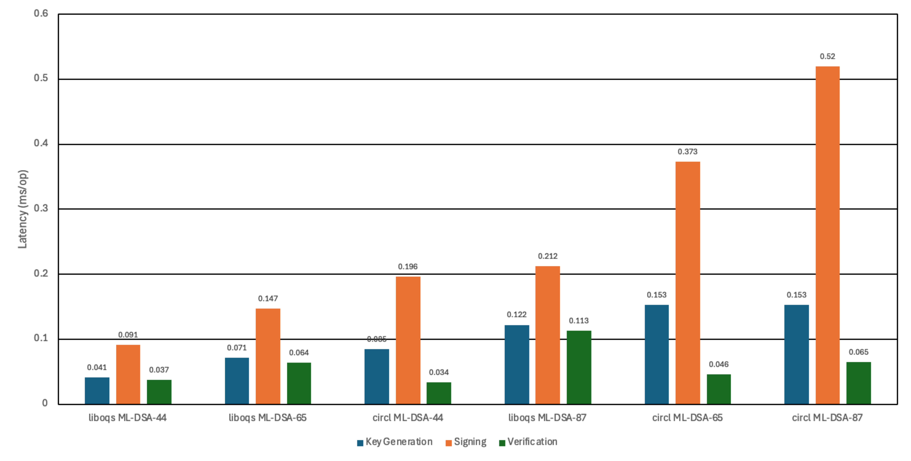

## 📊 Post-Quantum Cryptographic Performance Benchmarks

The following benchmarks demonstrate the speed and efficiency of post-quantum cryptography across the QChain ecosystem.

### 1. `go-bindings` (liboqs-go) — Production Implementation
*Optimized C-bindings via Open Quantum Safe (`liboqs`). Used across QChain's backend, blockchain anchor, and verification engine.*

| Operation | Algorithm | Security Level | Speed (ms/op) |
| :--- | :--- | :--- | :--- |
| **Key Generation** | ML-DSA | ML-DSA-44 | 0.041 |
| | | ML-DSA-65 | 0.071 | 
| | | ML-DSA-87 | 0.122 | 
| **Signing** | ML-DSA | ML-DSA-44 | 0.091 |
| | | ML-DSA-65 | 0.147 | 
| | | ML-DSA-87 | 0.212 | 
| **Verification** | ML-DSA | ML-DSA-44 | **0.037** |
| | | ML-DSA-65 | 0.064 | 
| | | ML-DSA-87 | 0.113 |
| **Total Sign & Verify Workflow** | ML-DSA | ML-DSA-44 | **0.167** |
| | | ML-DSA-65 | 0.280 | 
| | | ML-DSA-87 | 0.438 |

---

### 2. `go-native` (`crypto/mlkem` in Go 1.24+ Standard Library)
*Pure Go standard library implementation of NIST FIPS 203 (ML-KEM). Runs natively anywhere without CGo or external dependencies.*

| Operation | Algorithm | Security Level | Speed (ms/op) |
| :--- | :--- | :--- | :--- |
| **Key Generation** | ML-KEM | ML-KEM-768 | 0.024 |
| | | ML-KEM-1024 | 0.036 |
| **Encapsulation** | ML-KEM | ML-KEM-768 | 0.028 |
| | | ML-KEM-1024 | 0.041 |
| **Decapsulation** | ML-KEM | ML-KEM-768 | **0.025** |
| | | ML-KEM-1024 | 0.038 |
| **Total Key Exchange** | ML-KEM | ML-KEM-768 | **0.077** |
| | | ML-KEM-1024 | 0.115 |
| **Envelope Seal & Open (KEM + AES-256-GCM)** | Hybrid | ML-KEM-768 | **0.089** |
| | | ML-KEM-1024 | 0.128 |

---

### Key Presentation Findings
1. **Ultra-Fast Verification**: Post-quantum ML-DSA verification takes only **0.037 ms** (37 microseconds), which is comparable to or faster than classical RSA-2048 verification.
2. **Sub-Millisecond Key Exchange**: Go's native `crypto/mlkem` achieves a full post-quantum key exchange in **0.077 ms**, enabling instant off-chain envelope sealing.
3. **No Performance Penalty**: The cryptographic operations introduce virtually zero latency overhead compared to classical cryptography.

#

